# Database Schema Overview

This document summarizes the database structure used by this project, based on the application source code and SQL statements found in the PHP classes. It is intended as a practical schema reference for developers working on the system.

## 1. Database connection
The application connects to MySQL through the class [classes/Database.php](classes/Database.php).

Main behavior:
- Localhost / local environment uses MySQL host `127.0.0.1`
- Database name is usually `nbpa_data` or `nbpa_data_<subfolder>`
- Default credentials are defined in the code and vary by environment

Typical runtime connection logic:

```php
$dsn = 'mysql:host=' . $this->db_host . ';dbname=' . $this->db_name . ';charset=utf8';
$db = new PDO($dsn, $this->db_user, $this->db_pass);
```

---

## 2. Main tables in the system

The following tables are clearly referenced and used in the application code.

| Table name | Purpose | Main fields observed in code |
|---|---|---|
| `patient` | Main patient record | `id`, `super_id`, `super_pnum`, `sn_type`, `sn_year`, `sn_run`, `pnum`, `plabnum`, `ppre_name`, `pname`, `plastname`, `pgender`, `phospital_id`, `status_id`, `priority_id`, `pspecimen_id`, `create_date`, `create_by` |
| `hospital` | Hospital master data | `id`, `hospital`, `address`, `hdetail`, `tax_id`, `create_date`, `create_by` |
| `user` | System users / staff / clinicians | `id`, `pre_name`, `name`, `lastname`, `username`, `password`, `ugroup_id`, `uhospital_id`, `role`, `role_1`...`role_7`, `umobile`, `uemail`, `create_date`, `create_by` |
| `job` | Workflow/job assignments | `id`, `req_date`, `job_role_id`, `patient_id`, `result_id`, `patient_number`, `user_id`, `pre_name`, `name`, `lastname`, `jobname`, `pay`, `cost_count_per_day`, `comment`, `finish_date` |
| `service_billing` | Billing / invoice / service cost records | `id`, `req_id`, `specimen_id`, `patient_id`, `number`, `name`, `lastname`, `slide_type`, `code_description`, `description`, `nm_slide_count`, `sp_slide_block`, `sp_slide_count`, `import_date`, `report_date`, `hospital_id`, `hn`, `send_doctor`, `pathologist`, `cost`, `comment`, `create_date` |
| `service_price_list` | Service pricing master | `id`, `speciment_num`, `specimen`, `price` |
| `specimen` | Specimen definitions | likely includes specimen name and pricing metadata |
| `lab_fluid` | Laboratory fluid definitions | `labname`, `lab_des` |
| `log` | System event log | `id`, `username`, `name`, `event`, `detail`, `event_date` |
| `template_report` | Report templates | `id`, `user_id`, `reporttype_id`, `name`, `description` |
| `pdf_attach` | Attachments for patient records | `id`, `patient_id`, `filelocation`, `fileName`, `rec_create_date` |
| `internal_note` | Internal notes on patient | `id`, `patient_id`, `note`, `creater`, `editer`, `created_date`, `edit_date` |
| `nbnote` | Notes / rich text notes | `id`, `sub_id`, `content`, `create_date`, `rsv` |
| `presultupdate` | Result update records | `id`, `group_type`, `patient_id`, `result_type`, `result_type_id`, `result_message`, `pathologist_id`, `pathologist2_id`, `release_time`, `release_type` |
| `labelprint_tmp_a` | Temporary label printing queue | `id`, `userid`, `sn_num`, `hn_num`, `patho_abbreviation`, `speciment_abbreviation`, `accept_date`, `company_name` |
| `questionnaire_quality_cn` | CN questionnaire quality records | `id`, `patient_id`, `patient_num`, `score_specimen`, `score_staining`, `score_mounting`, `score_labeling`, `note` |
| `questionnaire_quality_sn` | SN questionnaire quality records | `id`, `patient_id`, `patient_num`, `score_thickness`, `score_staining`, `score_mounting`, `score_labeling`, `score_contaminate`, `note` |
| `req_id_sp_slide` | Slide request IDs tracking | `id`, `patient_id`, `job_id`, `req_date`, `finish_date`, `create_user_id`, `comment` |
| `user_groups` | Group / role category table | referenced in `user` queries (`JOIN user_groups`) |

---

## 3. Core entity relationships

### Patient-centric model
The strongest domain model in this project is centered around the `patient` table.

Typical relationships observed from code:
- `patient` belongs to a `hospital` via `phospital_id`
- `patient` belongs to a `specimen` via `pspecimen_id`
- `patient` is assigned to a `status_id` and `priority_id`
- `patient` has multiple workflow/job records in `job`
- `patient` can have billing records in `service_billing`
- `patient` may have notes and uploaded files (`internal_note`, `pdf_attach`, `nbnote`)

### User and hospital model
- `user` links to `hospital` via `uhospital_id`
- `user` links to `user_groups` via `ugroup_id`
- roles are represented as `role` and `role_1` ... `role_7`

### Billing and job workflow
- `job` stores work actions tied to a patient and a role
- `service_billing` stores costs and result details for laboratory services
- `service_price_list` provides product/service pricing information

---

## 4. Important table details inferred from code

### `patient`
This is the main operational table.

Common fields observed:
- Identification: `id`, `super_id`, `super_pnum`, `sn_type`, `sn_year`, `sn_run`, `pnum`, `plabnum`
- Personal info: `ppre_name`, `pname`, `plastname`, `pgender`, `pedge`
- Workflow: `status_id`, `priority_id`, `phospital_id`, `phospital_num`
- Related IDs: `ppathologist_id`, `pspecimen_id`, `pclinician_id`
- Diagnostic data: `p_rs_specimen`, `p_rs_clinical_diag`, `p_rs_gross_desc`, `p_rs_microscopic_desc`
- Price / lab data: `pprice`, `pspprice`, `p_slide_lab_id`, `p_slide_lab_price`
- Audit: `create_date`, `create_by`

### `user`
This table handles system identity and permission context.

Observed fields:
- `id`, `username`, `password`
- `pre_name`, `name`, `lastname`, `short_name`
- `ugroup_id`, `uhospital_id`
- `role`, `role_1`..`role_7`
- `udetail`, `umobile`, `uemail`

### `hospital`
Master table for hospitals / institutions.

Observed fields:
- `id`, `hospital`, `address`, `hdetail`, `tax_id`
- `create_date`, `create_by`

### `job`
Tracks work items or tasks assigned to staff.

Observed key fields:
- `id`, `req_date`, `job_role_id`, `patient_id`, `result_id`
- `patient_number`, `user_id`, `jobname`, `pay`, `comment`
- `finish_date`

### `service_billing`
Represents billable service line items.

Observed fields:
- `req_id`, `specimen_id`, `patient_id`, `number`, `name`, `lastname`
- `slide_type`, `code_description`, `description`
- `nm_slide_count`, `sp_slide_block`, `sp_slide_count`
- `import_date`, `report_date`, `hospital_id`, `hn`, `send_doctor`, `pathologist`
- `cost`, `comment`, `create_date`

---

## 5. Naming conventions used in the application

The codebase uses a mixed naming style:
- `snake_case` names such as `create_date`, `patient_id`, `hospital_id`
- `camelCase` names in some places such as `p_rs_gross_desc`, `movetotrash`
- table names sometimes use backticks and sometimes are plain SQL names
- some tables names are singular (`patient`, `job`, `user`) while others are descriptive (`service_billing`, `template_report`)

---

## 6. Notes about completeness

This document reflects the tables and fields visible in the PHP code and SQL statements in this repository. It is not a full exported schema dump from MySQL. If a production database is available, the next step should be to generate a real `SHOW CREATE TABLE` export and update this document for exact column types, constraints, and indexes.

---

## 7. Verified real tables from the SQL dump

The exported database file `nbpa_data_dev3.sql` is a MariaDB 10.4.22 dump for database `nbpa_data_dev3`, generated on 2026-10-11. Its DDL defines 35 InnoDB tables. The following names were read from its `CREATE TABLE` statements:

- `antibody_list`
- `changehistory`
- `gross_examination_record`
- `hire_list`
- `hospital`
- `internal_note`
- `invoice_list`
- `job`
- `job_role`
- `labelprint_tmp_a`
- `lab_fluid`
- `log`
- `nbnote`
- `nbnotetitle`
- `nb_note_record`
- `outside_contract`
- `patient`
- `pdf_attach`
- `presultupdate`
- `priority`
- `questionnaire_quality_cn`
- `questionnaire_quality_sn`
- `quilljs_test`
- `report_type`
- `req_id_sp_slide`
- `service_billing`
- `service_price_list`
- `service_type`
- `service_type_master`
- `sn_prefix`
- `status`
- `template_report`
- `testtiptap`
- `user`
- `user_groups`

This confirms that the database is not just a minimal patient system; it also includes operational modules for:
- pathology workflow / result entries
- label printing queue records
- hospital and user management
- billing and service pricing
- reporting and audit log tracking
- embedded notes and gross examination records

The dump contains clinical tables and descriptive column metadata. This review used table definitions, indexes, and constraints only; patient data rows were not used.

### DDL details confirmed in the dev3 dump

- All 35 tables use InnoDB. Character sets are mixed: most tables use `utf8mb4`, while some use `utf8`.
- Primary keys are declared for all tables except `report_type`, which declares a unique index on `id` instead.
- Additional unique indexes exist on `antibody_list.name`, `patient.pnum`, and `user.username`.
- The dump declares six foreign-key constraints. All use `ON DELETE CASCADE ON UPDATE CASCADE`:
    - `job.patient_id` -> `patient.id`
    - `job.job_role_id` -> `job_role.id`
    - `job.req_id` -> `req_id_sp_slide.id`
    - `req_id_sp_slide.patient_id` -> `patient.id`
    - `req_id_sp_slide.job_id` -> `job.id`
    - `service_billing.patient_id` -> `patient.id`
- Several other columns are indexed but are not declared as foreign keys. The dump does not declare foreign keys for the previously inferred hospital/user, patient/status, patient/specimen, result, note, or attachment links.
- The dump stores useful column comments, including Thai workflow descriptions on `patient` date/status fields, user role descriptions on `user.role_1` through `user.role_7`, and billing descriptions on `service_billing` fields.
- `specimen` is not a table in this dump; `service_price_list` is the pricing table and `patient.pspecimen_id` is an un-constrained integer column in this snapshot.

Treat this as the schema of the dev3 dump, not proof that every deployed environment has the same schema. Re-check a fresh dump before migrations or production changes.

---

## 8. Recommended next step

Compare this dev3 snapshot with a fresh production dump, then expand the data dictionary to include every column's exact type, default, nullability, and SQL comment. Keep declared constraints separate from relationships inferred from application queries.

---

## 9. ER Diagram

This is a conceptual diagram based on application workflow and query usage; it is not a map of only database-enforced foreign keys. The dev3 dump declares only the six foreign keys listed in section 7.

```mermaid
erDiagram
    HOSPITAL ||--o{ USER : has
    HOSPITAL ||--o{ PATIENT : receives
    USER ||--o{ JOB : handles
    PATIENT ||--o{ JOB : has
    PATIENT ||--o{ SERVICE_BILLING : billed
    PATIENT ||--o{ INTERNAL_NOTE : notes
    PATIENT ||--o{ PDF_ATTACH : files
    PATIENT ||--o{ PRESULTUPDATE : updates
    USER ||--o{ TEMPLATE_REPORT : creates
    USER_GROUPS ||--o{ USER : groups
    SERVICE_PRICE_LIST ||--o{ SERVICE_BILLING : pricing
    JOB_ROLE ||--o{ JOB : assigns
    PATIENT ||--o{ REQ_ID_SP_SLIDE : requests
    JOB ||--o{ REQ_ID_SP_SLIDE : creates

    HOSPITAL {
        int id PK
        string hospital
        string address
        text hdetail
        string tax_id
        string comment
    }

    USER_GROUPS {
        int id PK
        string name
        string comment
    }

    USER {
        int id PK
        string username
        string password
        string name
        string lastname
        int ugroup_id
        int uhospital_id
        string role
        string comment
    }

    PATIENT {
        int id PK
        int super_id
        string super_pnum
        string sn_type
        string sn_year
        int sn_run
        string pnum
        string plabnum
        string pname
        string plastname
        int phospital_id
        int status_id
        int priority_id
        int pspecimen_id
        int ppathologist_id
        int pclinician_id
        datetime create_date
        string comment
    }

    JOB {
        int id PK
        datetime req_date
        int job_role_id FK
        int patient_id FK
        int user_id
        string patient_number
        string jobname
        decimal pay
        datetime finish_date
        string comment
    }

    SERVICE_BILLING {
        int id PK
        int patient_id FK
        int specimen_id
        int hospital_id
        string number
        string name
        string lastname
        string hn
        decimal cost
        text description
        datetime create_date
        string comment
    }

    INTERNAL_NOTE {
        int id PK
        int patient_id
        int creator_id
        text note
        datetime created_date
        string comment
    }

    PDF_ATTACH {
        int id PK
        int patient_id
        string filelocation
        string fileName
        datetime rec_create_date
        string comment
    }

    PRESULTUPDATE {
        int id PK
        int patient_id
        int pathologist_id
        int pathologist2_id
        string result_type
        string result_message
        datetime release_time
        string comment
    }

    TEMPLATE_REPORT {
        int id PK
        int user_id
        int reporttype_id
        string name
        text description
        string comment
    }

    SERVICE_PRICE_LIST {
        int id PK
        int speciment_num
        string specimen
        decimal price
        string comment
    }

    JOB_ROLE {
        int id PK
        string name
        string name_e
        float cost_per_job
        int cost_count_per_day
    }

    ANTIBODY_LIST {
        int id PK
        string name
    }

    CHANGEHISTORY {
        int id PK
        string content
        datetime create_date
        int rsv
    }

    GROSS_EXAMINATION_RECORD {
        int id PK
        int sub_id
        text description
        text content
    }

    HIRE_LIST {
        int id PK
        int outside_id
        int patient_id
        string patient_number
        float cost
    }

    INVOICE_LIST {
        int id PK
        int order_list
        int group_type
        string invoice_name
        string mapping_rule
    }

    LABELPRINT_TMP_A {
        int id PK
        int userid
        string sn_num
        string hn_num
        string accept_date
    }

    LAB_FLUID {
        int id PK
        string labname
        text lab_des
    }

    LOG {
        int id PK
        string username
        text event
        text detail
        datetime event_date
    }

    NBNOTE {
        int id PK
        int sub_id
        text content
        datetime create_date
    }

    NBNOTETITLE {
        int id PK
        text title
        text createdate
    }

    NB_NOTE_RECORD {
        int id PK
        int sub_id
        string description
        text content
        timestamp create_date
    }

    OUTSIDE_CONTRACT {
        int id PK
        string name
        float cost
        string comment
    }

    PRIORITY {
        int id PK
        string priority
    }

    QUESTIONNAIRE_QUALITY_CN {
        int id PK
        int patient_id
        string patient_num
        int score_specimen
        text note
    }

    QUESTIONNAIRE_QUALITY_SN {
        int id PK
        int patient_id
        string patient_num
        int score_thickness
        text note
    }

    QUILLJS_TEST {
        int id PK
        text content
        timestamp create_date
    }

    REPORT_TYPE {
        int id UK
        int group_type
        string name
        string release_type
        text options
    }

    REQ_ID_SP_SLIDE {
        int id PK
        int patient_id FK
        int job_id FK
        datetime req_date
        datetime finish_date
        int create_user_id
    }

    SERVICE_TYPE {
        int id PK
        string service_type
        int group_type
        string service_type_e
    }

    SERVICE_TYPE_MASTER {
        int id PK
        int code
        int code2
        string description
        int price
    }

    SN_PREFIX {
        int id PK
        int order_list
        string name
        text description
    }

    STATUS {
        int id PK
        string des
        int next1
        int next2
        int next3
    }

    TESTTIPTAP {
        int id PK
        text content
    }
```



This visual highlights the primary system relationships: patients are managed by users in hospitals, patient workflow is tracked in jobs, and billing, notes, uploads, and result updates are attached to the patient record.

---

## 10. Fillable template for real data entry

Use this section to record the actual meanings of tables and fields as you learn more from the project.

### 1. Table: hospital
- Purpose: AAAA
- Key fields: BBBBB
- Important notes: CCCC
- Comment: DDDD

| Field | Comment |
|---|---|
| `id` | EEEEE |
| `hospital` | Example: official hospital name |
| `address` | Example: hospital location |

### 2. Table: user
- Purpose: 
- Key fields: 
- Important notes: 
- Comment: 

| Field | Comment |
|---|---|
| `id` | Example: user primary key |
| `username` | Example: login account name |
| `uhospital_id` | Example: linked hospital |

### 3. Table: patient
- Purpose: 
- Key fields: 
- Important notes: 
- Comment: 

| Field | Comment |
|---|---|
| `id` | Example: patient primary key |
| `pnum` | Example: patient case number |
| `phospital_id` | Example: hospital assignment |

### 4. Table: job
- Purpose: 
- Key fields: 
- Important notes: 
- Comment: 

| Field | Comment |
|---|---|
| `id` | Example: job primary key |
| `patient_id` | Example: target patient |
| `finish_date` | Example: completion date |

### 5. Table: service_billing
- Purpose: 
- Key fields: 
- Important notes: 
- Comment: 

| Field | Comment |
|---|---|
| `id` | Example: billing item primary key |
| `cost` | Example: total service cost |
| `patient_id` | Example: related patient |

### 6. Table: service_price_list
- Purpose: 
- Key fields: 
- Important notes: 
- Comment: 

| Field | Comment |
|---|---|
| `id` | Example: pricing row primary key |
| `specimen` | Example: specimen type or service name |
| `price` | Example: unit price |

### 7. Table: template_report
- Purpose: 
- Key fields: 
- Important notes: 
- Comment: 

| Field | Comment |
|---|---|
| `id` | Example: template primary key |
| `name` | Example: template display name |
| `description` | Example: report layout notes |

### 8. Table: labelprint_tmp_a
- Purpose: 
- Key fields: 
- Important notes: 
- Comment: 

| Field | Comment |
|---|---|
| `id` | Example: print queue row id |
| `sn_num` | Example: specimen number |
| `accept_date` | Example: accepted date for print |

### 9. Table: result / result update
- Purpose: 
- Key fields: 
- Important notes: 
- Comment: 

| Field | Comment |
|---|---|
| `id` | Example: result update primary key |
| `patient_id` | Example: result target patient |
| `result_message` | Example: final pathology result text |

### 10. Table: internal_note / nbnote
- Purpose: 
- Key fields: 
- Important notes: 
- Comment: 

| Field | Comment |
|---|---|
| `id` | Example: note primary key |
| `patient_id` | Example: associated patient |
| `note` | Example: internal case note |

### 11. Table: user_groups / status / priority / job_role
- Purpose: 
- Key fields: 
- Important notes: 
- Comment: 

| Field | Comment |
|---|---|
| `id` | Example: lookup key |
| `name` | Example: display label |
| `comment` | Example: free-form description |
