# Database Schema Overview

This document summarizes the database structure used by this project, based on the application source code and SQL statements found in the PHP classes. It is intended as a practical schema reference for developers working on the system.

## 1. Database connection
The application connects to MySQL through the class [classes/Database.php](classes/Database.php).

Main behavior:
- Localhost / local environment uses MySQL host `127.0.0.1`
- Database name is usually `nbpa_data` or `nbpa_data_<subfolder>`
- Default credentials are defined in the code and vary by environment

Typical runtime connection logic:

```php
$dsn = 'mysql:host=' . $this->db_host . ';dbname=' . $this->db_name . ';charset=utf8';
$db = new PDO($dsn, $this->db_user, $this->db_pass);
```

---

## 2. All database tables (35)

Complete table and column inventory from the dev3 SQL dump; names and fields match the HTML catalog.

| No. | Table | Purpose | Fields in dev3 dump |
|---:|---|---|---|
| 1 | `antibody_list` | Antibody name lookup. | id, name |
| 2 | `changehistory` | Change-history content and timestamp. | id, content, create_date, rsv |
| 3 | `gross_examination_record` | Gross examination descriptions and content. | id, sub_id, description, content, create_date, rsv |
| 4 | `hire_list` | Outsourced work records linked to a contract and patient. | id, outside_id, patient_id, patient_number, name, cost, comment, accept_time, insert_time, finish_time, create_date |
| 5 | `hospital` | Hospital details and report-folder settings. | id, hospital, address, hdetail, user_id, tax_id, create_date, create_by, reportfolder, movetotrash |
| 6 | `internal_note` | Internal patient notes and edit metadata. | id, patient_id, note, creater, editer, created_date, edit_date |
| 7 | `invoice_list` | Invoice names, grouping, mapping rules, and service type. | id, order_list, group_type, invoice_name, invoice_name_e, mapping_rule, sn_type, service_type |
| 8 | `job` | Patient workflow assignments, role, owner, payment, and completion. | id, req_date, req_finish_date, req_id, job_role_id, patient_id, result_id, patient_number, user_id, pre_name, name, lastname, jobname, pay, cost_count_per_day, comment, finish_date, insert_time, second_patho_review, request_sp_slide, qty, movetotrash |
| 9 | `job_role` | Job role names and per-job/day cost settings. | id, name, name_e, cost_per_job, cost_count_per_day, create_date |
| 10 | `labelprint_tmp_a` | Temporary label-print queue. | id, userid, sn_num, hn_num, patho_abbreviation, speciment_abbreviation, accept_date, company_name, create_date |
| 11 | `lab_fluid` | Laboratory fluid definitions. | id, labname, lab_des, create_date |
| 12 | `log` | User event and detail log. | id, username, name, event, detail, event_date |
| 13 | `nbnote` | Rich-text note content. | id, sub_id, content, create_date, rsv |
| 14 | `nbnotetitle` | Note title records. | id, title, createdate |
| 15 | `nb_note_record` | Note records with description and content. | id, sub_id, description, content, create_date, rsv |
| 16 | `outside_contract` | External contract names and costs. | id, name, cost, comment, create_date |
| 17 | `patient` | Pathology case identity, workflow dates/status, assignments, and result text. | id, super_id, super_pnum, sn_type, sn_year, sn_run, pnum, plabnum, ppre_name, pname, pgender, plastname, pedge, date_1000, date_2000, date_3000, date_6000, date_8000, date_10000, date_12000, date_13000, date_14000, date_20000, date_first_report, tr_time, status_id, priority_id, phospital_id, p_speciment_type, phospital_num, ppathologist_id, pspecimen_id, pclinician_id, p_cross_section_id, p_cross_section_ass_id, p_slide_prep_id, p_slide_prep_sp_id, p_sp_patho_comment, pprice, pspprice, p_rs_specimen, p_slide_lab_id, p_slide_lab_price, p_rs_clinical_diag, p_rs_gross_desc, p_rs_microscopic_desc, iscritical, reported_as, reported_name, isautoeditmode, pautoscroll, second_patho_review, request_sp_slide, create_date, create_by, edit_date, movetotrash, job1qty, job2qty, job3qty |
| 18 | `pdf_attach` | Patient-related PDF attachment path and metadata. | id, filelocation, rec_create_date, patient_id, fileName |
| 19 | `presultupdate` | Patient result updates, result type, pathologists, and release metadata. | id, group_type, patient_id, result_type, result_type_id, result_message, pathologist_id, pathologist2_id, release_time, release_type, second_patho_review, create_date |
| 20 | `priority` | Case priority labels. | id, priority |
| 21 | `questionnaire_quality_cn` | CN specimen quality questionnaire scores and notes. | id, patient_id, patient_num, score_specimen, score_staining, score_mounting, score_labeling, note |
| 22 | `questionnaire_quality_sn` | SN slide quality questionnaire scores and notes. | id, patient_id, patient_num, score_thickness, score_staining, score_mounting, score_labeling, score_contaminate, note |
| 23 | `quilljs_test` | Rich-text editor test content. | id, content, create_date, rsv |
| 24 | `report_type` | Report groups, release type, and options. | id, group_type, name, release_type, options |
| 25 | `req_id_sp_slide` | Special-slide request and completion tracking. | id, patient_id, job_id, req_date, finish_date, create_user_id, comment, movetotrash |
| 26 | `service_billing` | Patient service/billing line items and costs. | id, req_date, req_finish_date, req_id, specimen_id, patient_id, number, name, lastname, slide_type, code_description, code2, description, nm_slide_count, sp_slide_block, sp_slide_count, import_date, report_date, price_hospital, hospital_id, hn, send_doctor, pathologist, cost, comment, create_date |
| 27 | `service_price_list` | Hospital/service pricing and specimen metadata. | id, number, speciment_num, code2, jobtype, specimen, hospital_id, unit_count, price, comment, create_date, add_user_id, edit_user_id, service_des |
| 28 | `service_type` | Service type labels and billing mappings. | id, order_list, group_type, service_type, service_typea_id, service_typea_bill, service_type_bill, service_type_e, name_by_spcimen |
| 29 | `service_type_master` | Service codes, descriptions, units, and prices. | id, code, code2, description, service_typeb_id, service_typeb_description, unit_count, price |
| 30 | `sn_prefix` | Surgical-number prefix and descriptions. | id, order_list, name, description, description_e |
| 31 | `status` | Workflow status descriptions and next/back transitions. | id, des, next1, next2, next3, back1, back2 |
| 32 | `template_report` | User-owned report template name and description. | id, user_id, reporttype_id, name, description |
| 33 | `testtiptap` | Rich-text editor test content. | id, content |
| 34 | `user` | Staff identity, roles, credentials, and hospital/group assignment. | id, username, password, pre_name, name, lastname, pre_name_e, name_e, lastname_e, short_name, educational_bf, role, role_1, role_2, role_3, role_4, role_5, role_6, role_7, role_a, can_manaage_job, udetail, umobile, uemail, ugroup_id, uhospital_id, signature_file, profile_file, user_status, user_type, create_date, create_by, movetotrash |
| 35 | `user_groups` | User group names. | id, ugroup, ugroup_e |


## 3. Core entity relationships

### Patient-centric model
The strongest domain model in this project is centered around the `patient` table.

Typical relationships observed from code:
- `patient` belongs to a `hospital` via `phospital_id`
- `patient` belongs to a `specimen` via `pspecimen_id`
- `patient` is assigned to a `status_id` and `priority_id`
- `patient` has multiple workflow/job records in `job`
- `patient` can have billing records in `service_billing`
- `patient` may have notes and uploaded files (`internal_note`, `pdf_attach`, `nbnote`)

### User and hospital model
- `user` links to `hospital` via `uhospital_id`
- `user` links to `user_groups` via `ugroup_id`
- roles are represented as `role` and `role_1` ... `role_7`

### Billing and job workflow
- `job` stores work actions tied to a patient and a role
- `service_billing` stores costs and result details for laboratory services
- `service_price_list` provides product/service pricing information

---

## 4. Important table details inferred from code

### `patient`
This is the main operational table.

Common fields observed:
- Identification: `id`, `super_id`, `super_pnum`, `sn_type`, `sn_year`, `sn_run`, `pnum`, `plabnum`
- Personal info: `ppre_name`, `pname`, `plastname`, `pgender`, `pedge`
- Workflow: `status_id`, `priority_id`, `phospital_id`, `phospital_num`
- Related IDs: `ppathologist_id`, `pspecimen_id`, `pclinician_id`
- Diagnostic data: `p_rs_specimen`, `p_rs_clinical_diag`, `p_rs_gross_desc`, `p_rs_microscopic_desc`
- Price / lab data: `pprice`, `pspprice`, `p_slide_lab_id`, `p_slide_lab_price`
- Audit: `create_date`, `create_by`

### `user`
This table handles system identity and permission context.

Observed fields:
- `id`, `username`, `password`
- `pre_name`, `name`, `lastname`, `short_name`
- `ugroup_id`, `uhospital_id`
- `role`, `role_1`..`role_7`
- `udetail`, `umobile`, `uemail`

### `hospital`
Master table for hospitals / institutions.

Observed fields:
- `id`, `hospital`, `address`, `hdetail`, `tax_id`
- `create_date`, `create_by`

### `job`
Tracks work items or tasks assigned to staff.

Observed key fields:
- `id`, `req_date`, `job_role_id`, `patient_id`, `result_id`
- `patient_number`, `user_id`, `jobname`, `pay`, `comment`
- `finish_date`

### `service_billing`
Represents billable service line items.

Observed fields:
- `req_id`, `specimen_id`, `patient_id`, `number`, `name`, `lastname`
- `slide_type`, `code_description`, `description`
- `nm_slide_count`, `sp_slide_block`, `sp_slide_count`
- `import_date`, `report_date`, `hospital_id`, `hn`, `send_doctor`, `pathologist`
- `cost`, `comment`, `create_date`

---

## 5. Naming conventions used in the application

The codebase uses a mixed naming style:
- `snake_case` names such as `create_date`, `patient_id`, `hospital_id`
- `camelCase` names in some places such as `p_rs_gross_desc`, `movetotrash`
- table names sometimes use backticks and sometimes are plain SQL names
- some tables names are singular (`patient`, `job`, `user`) while others are descriptive (`service_billing`, `template_report`)

---

## 6. Notes about completeness

This document reflects the tables and fields visible in the PHP code and SQL statements in this repository. It is not a full exported schema dump from MySQL. If a production database is available, the next step should be to generate a real `SHOW CREATE TABLE` export and update this document for exact column types, constraints, and indexes.

---

## 7. Verified real tables from the SQL dump

The exported database file `nbpa_data_dev3.sql` is a MariaDB 10.4.22 dump for database `nbpa_data_dev3`, generated on 2026-10-11. Its DDL defines 35 InnoDB tables. The following names were read from its `CREATE TABLE` statements:

- `antibody_list`
- `changehistory`
- `gross_examination_record`
- `hire_list`
- `hospital`
- `internal_note`
- `invoice_list`
- `job`
- `job_role`
- `labelprint_tmp_a`
- `lab_fluid`
- `log`
- `nbnote`
- `nbnotetitle`
- `nb_note_record`
- `outside_contract`
- `patient`
- `pdf_attach`
- `presultupdate`
- `priority`
- `questionnaire_quality_cn`
- `questionnaire_quality_sn`
- `quilljs_test`
- `report_type`
- `req_id_sp_slide`
- `service_billing`
- `service_price_list`
- `service_type`
- `service_type_master`
- `sn_prefix`
- `status`
- `template_report`
- `testtiptap`
- `user`
- `user_groups`

This confirms that the database is not just a minimal patient system; it also includes operational modules for:
- pathology workflow / result entries
- label printing queue records
- hospital and user management
- billing and service pricing
- reporting and audit log tracking
- embedded notes and gross examination records

The dump contains clinical tables and descriptive column metadata. This review used table definitions, indexes, and constraints only; patient data rows were not used.

### DDL details confirmed in the dev3 dump

- All 35 tables use InnoDB. Character sets are mixed: most tables use `utf8mb4`, while some use `utf8`.
- Primary keys are declared for all tables except `report_type`, which declares a unique index on `id` instead.
- Additional unique indexes exist on `antibody_list.name`, `patient.pnum`, and `user.username`.
- The dump declares six foreign-key constraints. All use `ON DELETE CASCADE ON UPDATE CASCADE`:
    - `job.patient_id` -> `patient.id`
    - `job.job_role_id` -> `job_role.id`
    - `job.req_id` -> `req_id_sp_slide.id`
    - `req_id_sp_slide.patient_id` -> `patient.id`
    - `req_id_sp_slide.job_id` -> `job.id`
    - `service_billing.patient_id` -> `patient.id`
- Several other columns are indexed but are not declared as foreign keys. The dump does not declare foreign keys for the previously inferred hospital/user, patient/status, patient/specimen, result, note, or attachment links.
- The dump stores useful column comments, including Thai workflow descriptions on `patient` date/status fields, user role descriptions on `user.role_1` through `user.role_7`, and billing descriptions on `service_billing` fields.
- `specimen` is not a table in this dump; `service_price_list` is the pricing table and `patient.pspecimen_id` is an un-constrained integer column in this snapshot.

Treat this as the schema of the dev3 dump, not proof that every deployed environment has the same schema. Re-check a fresh dump before migrations or production changes.

---

## 8. Recommended next step

Compare this dev3 snapshot with a fresh production dump, then expand the data dictionary to include every column's exact type, default, nullability, and SQL comment. Keep declared constraints separate from relationships inferred from application queries.

---

## 9. ER Diagram

This conceptual diagram is based on application workflow. Declared database foreign keys are listed in section 7; other relationships are inferred from application usage.


Each table is numbered in catalog order. Column types are omitted in this overview; field names and comments are shown.

### Tables with relationships

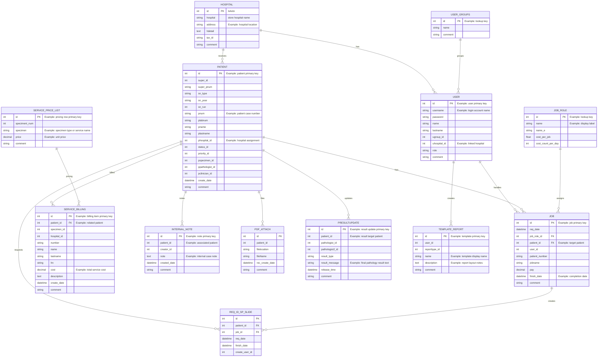

### Remaining tables

```mermaid
erDiagram

            ANTIBODY_LIST {
              int id PK "aaa"
              string name
            }

            CHANGEHISTORY {
              int id PK
              string content
              datetime create_date
              int rsv
            }

            GROSS_EXAMINATION_RECORD {
              int id PK "aaaa"
              int sub_id
              text description
              text content
            }

            HIRE_LIST {
              int id PK
              int outside_id
              int patient_id
              string patient_number
              float cost
            }

            INVOICE_LIST {
              int id PK
              int order_list
              int group_type
              string invoice_name
              string mapping_rule
            }

            LABELPRINT_TMP_A {
              int id PK "Example: print queue row id"
              int userid
              string sn_num "Example: specimen number"
              string hn_num
              string accept_date "Example: accepted date for print"
            }

            LAB_FLUID {
              int id PK
              string labname
              text lab_des
            }

            LOG {
              int id PK
              string username
              text event
              text detail
              datetime event_date
            }

            NBNOTE {
              int id PK "Example: note primary key"
              int sub_id
              text content
              datetime create_date
            }

            NBNOTETITLE {
              int id PK
              text title
              text createdate
            }

            NB_NOTE_RECORD {
              int id PK
              int sub_id
              string description
              text content
              timestamp create_date
            }

            OUTSIDE_CONTRACT {
              int id PK
              string name
              float cost
              string comment "Example: free-form description"
            }

            PRIORITY {
              int id PK "Example: lookup key"
              string priority
            }

            QUESTIONNAIRE_QUALITY_CN {
              int id PK
              int patient_id
              string patient_num
              int score_specimen
              text note
            }

            QUESTIONNAIRE_QUALITY_SN {
              int id PK
              int patient_id
              string patient_num
              int score_thickness
              text note
            }

            QUILLJS_TEST {
              int id PK
              text content
              timestamp create_date
            }

            REPORT_TYPE {
              int id UK
              int group_type
              string name
              string release_type
              text options
            }

            SERVICE_TYPE {
              int id PK
              string service_type
              int group_type
              string service_type_e
            }

            SERVICE_TYPE_MASTER {
              int id PK
              int code
              int code2
              string description
              int price
            }

            SN_PREFIX {
              int id PK
              int order_list
              string name
              text description
            }

            STATUS {
              int id PK "Example: lookup key"
              string des
              int next1
              int next2
              int next3
            }

            TESTTIPTAP {
              int id PK
              text content
            }
```

## 10. Fillable template for real data entry

Use this section to record the actual meanings of tables and fields as you learn more from the project.

### 1. Table: antibody_list
- Purpose: 
- Key fields: id, name
- Important notes: 
- Comment: 

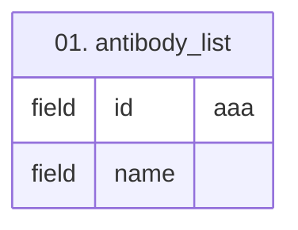

| Field | SQL Type | Key | Comment |
|---|---|---|---|
| `id` | `int(11)` | PK | aaa |
| `name` | `varchar(20)` | UK |  |

### 2. Table: changehistory
- Purpose: 
- Key fields: id, content, create_date, rsv
- Important notes: 
- Comment: 

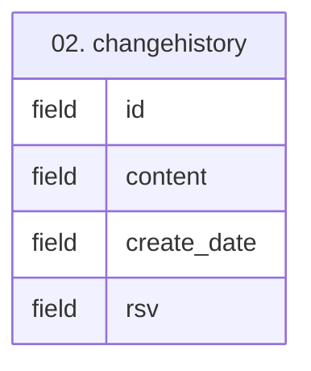

| Field | SQL Type | Key | Comment |
|---|---|---|---|
| `id` | `int(11)` | PK |  |
| `content` | `text` |  |  |
| `create_date` | `datetime` |  |  |
| `rsv` | `int(11)` |  |  |

### 3. Table: gross_examination_record
- Purpose: 
- Key fields: id, sub_id, description, content, create_date, rsv
- Important notes: 
- Comment: 

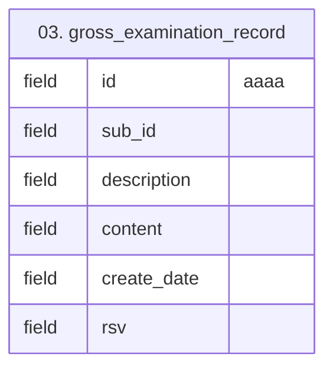

| Field | SQL Type | Key | Comment |
|---|---|---|---|
| `id` | `int(11)` | PK | aaaa |
| `sub_id` | `int(11)` |  |  |
| `description` | `text` |  |  |
| `content` | `text` |  |  |
| `create_date` | `datetime` |  |  |
| `rsv` | `int(11)` |  |  |

### 4. Table: hire_list
- Purpose: 
- Key fields: id, outside_id, patient_id, patient_number, name, cost, comment, accept_time, insert_time, finish_time, create_date
- Important notes: 
- Comment: 

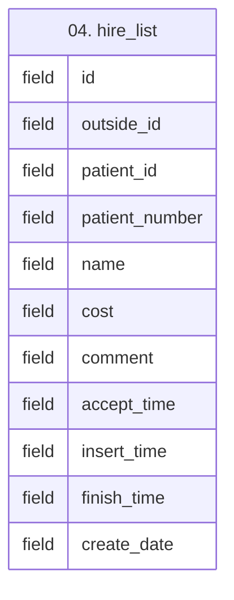

| Field | SQL Type | Key | Comment |
|---|---|---|---|
| `id` | `int(11)` | PK |  |
| `outside_id` | `int(11)` |  | Link to outside_contract |
| `patient_id` | `int(11)` |  |  |
| `patient_number` | `varchar(10)` |  |  |
| `name` | `varchar(50)` |  |  |
| `cost` | `float` |  |  |
| `comment` | `varchar(70)` |  |  |
| `accept_time` | `datetime` |  |  |
| `insert_time` | `datetime` |  |  |
| `finish_time` | `datetime` |  |  |
| `create_date` | `datetime` |  |  |

### 5. Table: hospital
- Purpose: AAA
- Key fields: BBBB
- Important notes: CCCC
- Comment: DDDD

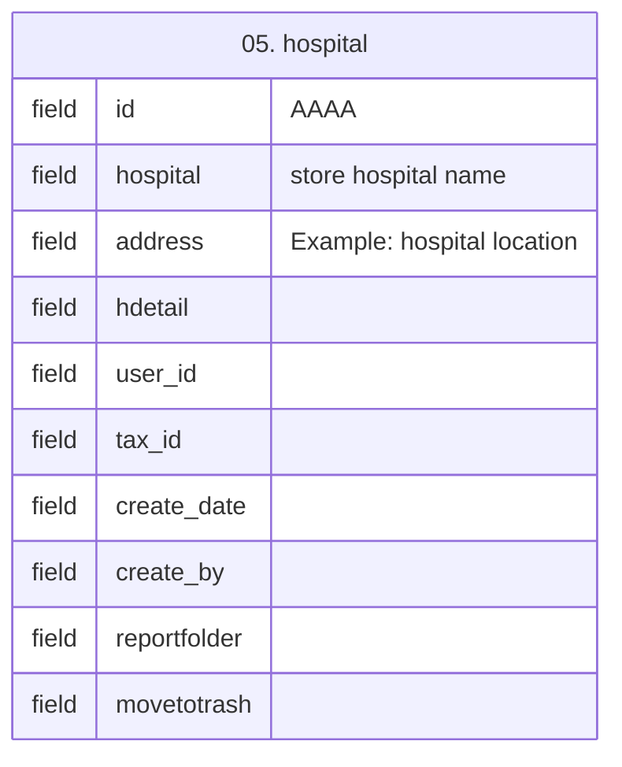

| Field | SQL Type | Key | Comment |
|---|---|---|---|
| `id` | `int(11)` | PK | AAAA |
| `hospital` | `varchar(64)` |  | store hospital name |
| `address` | `text` |  | Example: hospital location |
| `hdetail` | `text` |  |  |
| `user_id` | `int(11)` |  | Link to user in case of user for hostpital. |
| `tax_id` | `varchar(50)` |  |  |
| `create_date` | `datetime` |  |  |
| `create_by` | `varchar(80)` |  |  |
| `reportfolder` | `text` |  |  |
| `movetotrash` | `tinyint(4)` |  |  |

### 6. Table: internal_note
- Purpose: 
- Key fields: 
- Important notes: 
- Comment: 

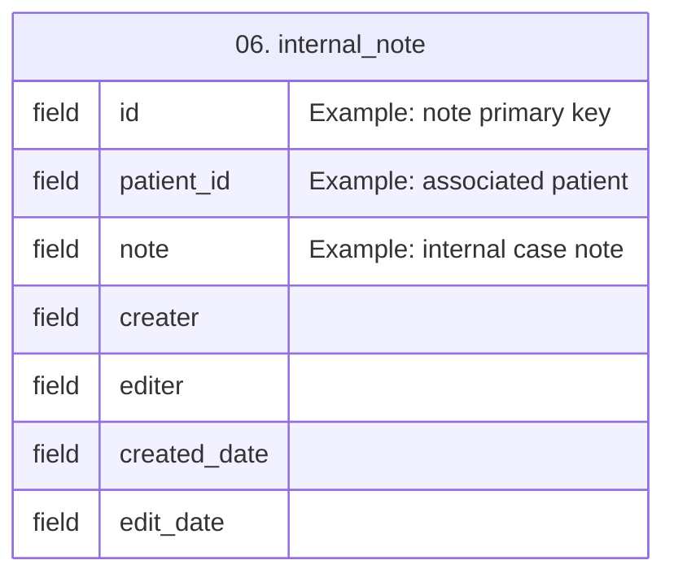

| Field | SQL Type | Key | Comment |
|---|---|---|---|
| `id` | `int(11)` | PK | Example: note primary key |
| `patient_id` | `int(11)` |  | Example: associated patient |
| `note` | `text` |  | Example: internal case note |
| `creater` | `text` |  |  |
| `editer` | `text` |  |  |
| `created_date` | `datetime` |  |  |
| `edit_date` | `datetime` |  |  |

### 7. Table: invoice_list
- Purpose: 
- Key fields: id, order_list, group_type, invoice_name, invoice_name_e, mapping_rule, sn_type, service_type
- Important notes: 
- Comment: 

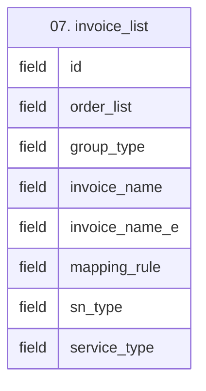

| Field | SQL Type | Key | Comment |
|---|---|---|---|
| `id` | `int(11)` | PK |  |
| `order_list` | `int(11)` |  |  |
| `group_type` | `int(11)` |  |  |
| `invoice_name` | `varchar(120)` |  |  |
| `invoice_name_e` | `varchar(120)` |  |  |
| `mapping_rule` | `varchar(256)` |  |  |
| `sn_type` | `varchar(2)` |  |  |
| `service_type` | `int(11)` |  |  |

### 8. Table: job
- Purpose: 
- Key fields: 
- Important notes: 
- Comment: 

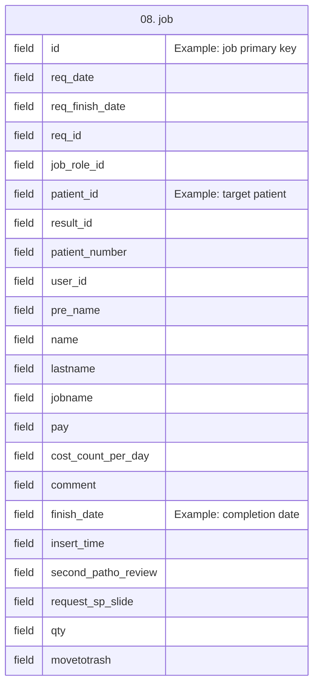

| Field | SQL Type | Key | Comment |
|---|---|---|---|
| `id` | `int(11)` | PK | Example: job primary key |
| `req_date` | `datetime` |  |  |
| `req_finish_date` | `datetime` |  |  |
| `req_id` | `int(11)` | INDEX, FK |  |
| `job_role_id` | `int(11)` | INDEX, FK | ID Link to table Job Role |
| `patient_id` | `int(11)` | INDEX, FK | Example: target patient |
| `result_id` | `int(11)` | INDEX | UN-USED. this file use only second patho confirm |
| `patient_number` | `varchar(10)` |  | ex sergical number |
| `user_id` | `int(11)` |  | id of the Job Owner |
| `pre_name` | `varchar(20)` |  | pre name Job Owner |
| `name` | `varchar(30)` |  | Name Of Job Owner |
| `lastname` | `varchar(30)` |  | Last name Of Job Owner |
| `jobname` | `varchar(30)` |  | Name of Job |
| `pay` | `float` |  | Cost to pay for the Job |
| `cost_count_per_day` | `int(11)` |  |  |
| `comment` | `varchar(50)` |  | Comment |
| `finish_date` | `datetime` |  | Example: completion date |
| `insert_time` | `datetime` |  |  |
| `second_patho_review` | `tinyint(4)` |  | 1 wait for review 2 approved |
| `request_sp_slide` | `tinyint(4)` |  | 1 requested  2 finish |
| `qty` | `int(11)` |  |  |
| `movetotrash` | `tinyint(4)` |  |  |

### 9. Table: job_role
- Purpose: 
- Key fields: id, name, name_e, cost_per_job, cost_count_per_day, create_date
- Important notes: 
- Comment: 

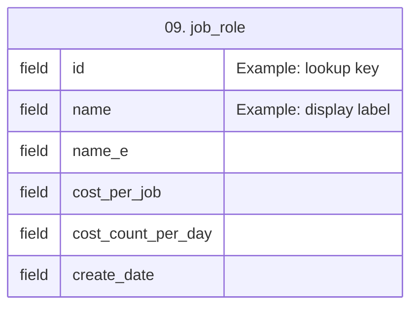

| Field | SQL Type | Key | Comment |
|---|---|---|---|
| `id` | `int(11)` | PK | Example: lookup key |
| `name` | `varchar(20)` |  | Example: display label |
| `name_e` | `varchar(30)` |  |  |
| `cost_per_job` | `float` |  |  |
| `cost_count_per_day` | `int(11)` |  | Pay when count more then the value |
| `create_date` | `datetime` |  |  |

### 10. Table: labelprint_tmp_a
- Purpose: 
- Key fields: 
- Important notes: 
- Comment: 

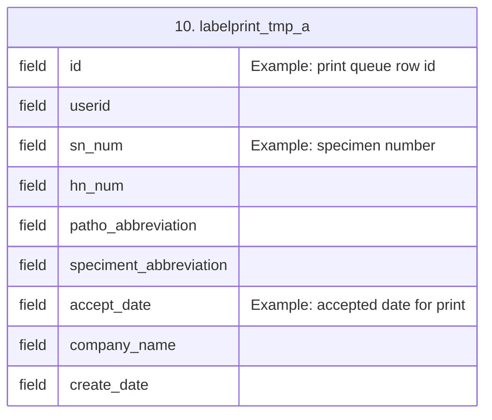

| Field | SQL Type | Key | Comment |
|---|---|---|---|
| `id` | `int(11)` | PK | Example: print queue row id |
| `userid` | `int(11)` |  |  |
| `sn_num` | `varchar(10)` |  | Example: specimen number |
| `hn_num` | `varchar(30)` |  |  |
| `patho_abbreviation` | `varchar(10)` |  |  |
| `speciment_abbreviation` | `varchar(4)` |  |  |
| `accept_date` | `varchar(30)` |  | Example: accepted date for print |
| `company_name` | `varchar(15)` |  |  |
| `create_date` | `datetime` |  |  |

### 11. Table: lab_fluid
- Purpose: 
- Key fields: id, labname, lab_des, create_date
- Important notes: 
- Comment: 

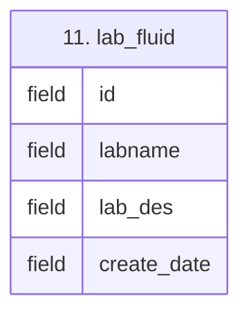

| Field | SQL Type | Key | Comment |
|---|---|---|---|
| `id` | `int(11)` | PK |  |
| `labname` | `varchar(30)` |  |  |
| `lab_des` | `text` |  |  |
| `create_date` | `datetime` |  |  |

### 12. Table: log
- Purpose: 
- Key fields: id, username, name, event, detail, event_date
- Important notes: 
- Comment: 

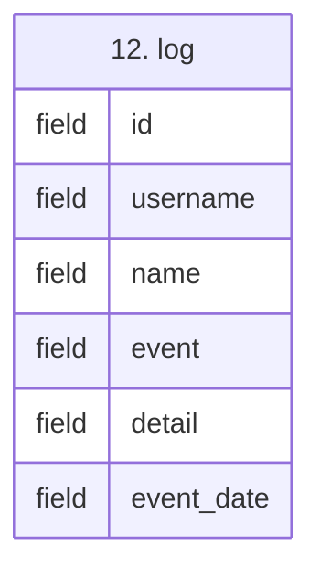

| Field | SQL Type | Key | Comment |
|---|---|---|---|
| `id` | `int(11)` | PK |  |
| `username` | `char(64)` |  |  |
| `name` | `char(64)` |  |  |
| `event` | `text` |  |  |
| `detail` | `text` |  |  |
| `event_date` | `datetime` |  |  |

### 13. Table: nbnote
- Purpose: 
- Key fields: id, sub_id, content, create_date, rsv
- Important notes: 
- Comment: 

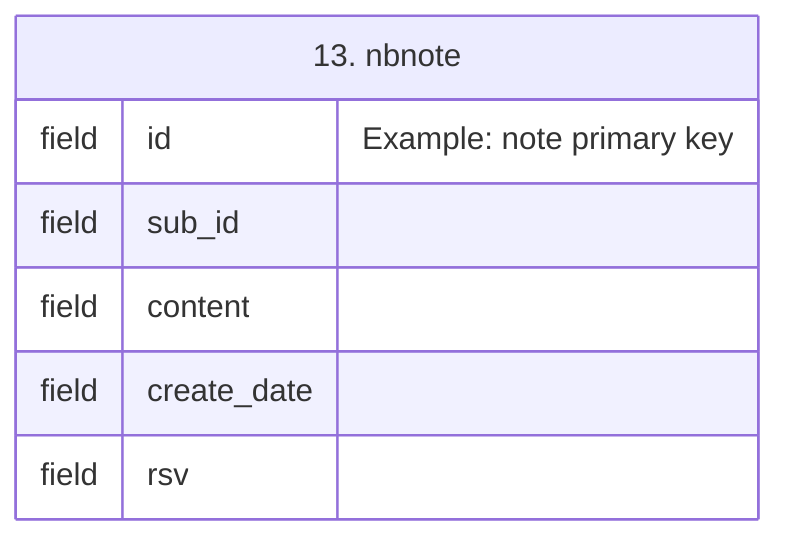

| Field | SQL Type | Key | Comment |
|---|---|---|---|
| `id` | `int(11)` | PK | Example: note primary key |
| `sub_id` | `int(11)` |  |  |
| `content` | `text` |  |  |
| `create_date` | `datetime` |  |  |
| `rsv` | `int(11)` |  |  |

### 14. Table: nbnotetitle
- Purpose: 
- Key fields: id, title, createdate
- Important notes: 
- Comment: 

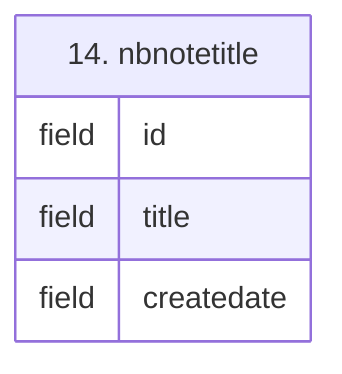

| Field | SQL Type | Key | Comment |
|---|---|---|---|
| `id` | `int(11)` | PK |  |
| `title` | `text` |  |  |
| `createdate` | `text` |  |  |

### 15. Table: nb_note_record
- Purpose: 
- Key fields: id, sub_id, description, content, create_date, rsv
- Important notes: 
- Comment: 

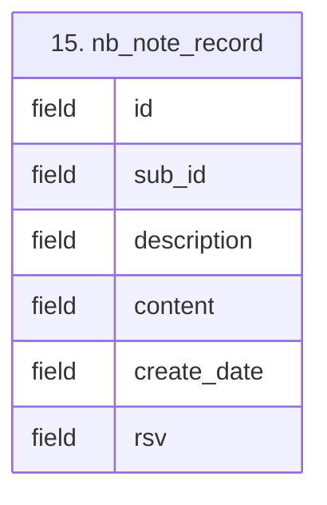

| Field | SQL Type | Key | Comment |
|---|---|---|---|
| `id` | `int(11)` | PK |  |
| `sub_id` | `int(11)` |  |  |
| `description` | `varchar(255)` |  |  |
| `content` | `text` |  |  |
| `create_date` | `timestamp` |  |  |
| `rsv` | `varchar(255)` |  |  |

### 16. Table: outside_contract
- Purpose: 
- Key fields: id, name, cost, comment, create_date
- Important notes: 
- Comment: 

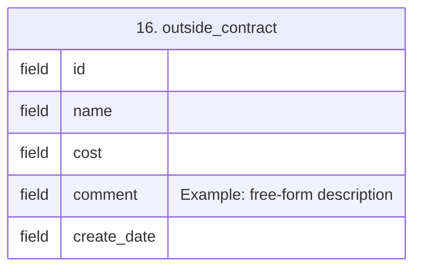

| Field | SQL Type | Key | Comment |
|---|---|---|---|
| `id` | `int(11)` | PK |  |
| `name` | `varchar(50)` |  |  |
| `cost` | `float` |  |  |
| `comment` | `varchar(70)` |  | Example: free-form description |
| `create_date` | `datetime` |  |  |

### 17. Table: patient
- Purpose: 
- Key fields: 
- Important notes: 
- Comment: 

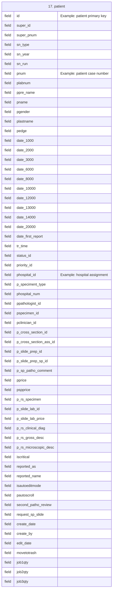

| Field | SQL Type | Key | Comment |
|---|---|---|---|
| `id` | `int(11)` | PK | Example: patient primary key |
| `super_id` | `int(11)` |  |  |
| `super_pnum` | `varchar(32)` |  |  |
| `sn_type` | `varchar(2)` |  | เลขชนิดคนไข้ |
| `sn_year` | `varchar(4)` |  | เลขปีของเลขคนไข้ |
| `sn_run` | `int(11)` |  | เลขรันนิ่งของเลขที่คนไข้ |
| `pnum` | `varchar(32)` | UK | Example: patient case number |
| `plabnum` | `text` |  | แลปนัมเบอร์ |
| `ppre_name` | `varchar(20)` |  | คำน้ำหน้าชื่อ นาย นาง นางสาว |
| `pname` | `varchar(64)` |  | ชื่อคนไข้ |
| `pgender` | `varchar(10)` |  | เพศ |
| `plastname` | `varchar(64)` |  | นามสกุล |
| `pedge` | `int(11)` |  | อายุ |
| `date_1000` | `datetime` |  | วันที่รับเข้า |
| `date_2000` | `datetime` |  | วันที่วางแผน |
| `date_3000` | `datetime` |  | วันที่เตรียมชิ้นเนื้อแล้ว |
| `date_6000` | `datetime` |  | วันที่เตรียมสไลด์แล้ว |
| `date_8000` | `datetime` |  | วันที่เตรียมชิ้นเนื้อย้อมพิเศษแล้ว |
| `date_10000` | `datetime` |  | วันที่ทำแลปเซลวิทยาแล้ว |
| `date_12000` | `datetime` |  | วันที่อ่านผลการวินิจฉัย |
| `date_13000` | `datetime` |  | วันที่ดับเบิ้ลคอนเฟริ์ม |
| `date_14000` | `datetime` |  | To be remove |
| `date_20000` | `datetime` |  | วันที่เสร็จสิ้น |
| `date_first_report` | `datetime` |  | วันที่ออกรีพอทครั้งแรก |
| `tr_time` | `float` |  |  |
| `status_id` | `int(11)` |  | สถานะงาน |
| `priority_id` | `tinyint(4)` |  | ความสำคัญ ปกติ ด่วน |
| `phospital_id` | `int(11)` | INDEX | Example: hospital assignment |
| `p_speciment_type` | `varchar(10)` |  | ชิ้นเนื้อหรือของเหลว |
| `phospital_num` | `text` |  | เลขที่โรงพยาบาล |
| `ppathologist_id` | `int(11)` | INDEX | to be remove ผู้อ่านผล |
| `pspecimen_id` | `int(11)` | INDEX | to be remove ไอดีชนิดชิ้นเนื้อ |
| `pclinician_id` | `int(11)` | INDEX | ไอดีลิ้งไปหาแพทย์ผู้ส่ง |
| `p_cross_section_id` | `int(11)` | INDEX | to be remove พนักงาน ตัดเนื้อ |
| `p_cross_section_ass_id` | `int(11)` | INDEX | to be remove ผู้ช่วยตัดเนื้อ |
| `p_slide_prep_id` | `int(11)` | INDEX | to be remove พนักงานเตรียม สไลด์ |
| `p_slide_prep_sp_id` | `int(11)` | INDEX | พนักงานเตรียมสไลด์พิเศษ |
| `p_sp_patho_comment` | `text` |  | Patho put comment |
| `pprice` | `int(11)` |  | ราคาเตรียมชิ้นเนื้อและเตรียมสไลด์ |
| `pspprice` | `int(11)` |  | to be remove ราคาเตรียมสไลดพิเศษ |
| `p_rs_specimen` | `text` |  | patient result specimen |
| `p_slide_lab_id` | `int(11)` | INDEX | แลปน้ำ ไอดี |
| `p_slide_lab_price` | `int(11)` |  | ราคาค่าตรวจแลปน้ำ |
| `p_rs_clinical_diag` | `text` |  | patient result clinical dianosis |
| `p_rs_gross_desc` | `text` |  | patient result gross description |
| `p_rs_microscopic_desc` | `text` |  | petient result microscopic description |
| `iscritical` | `tinyint(4)` |  | 0:Normal  1:Critical |
| `reported_as` | `varchar(30)` |  | ยังไม่ออกผล/ออกผลเบื้องต้น/ออกผลแล้ว |
| `reported_name` | `varchar(30)` |  | ชนิดของการออกผลล่าสุด |
| `isautoeditmode` | `varchar(30)` |  | Location to set autoedit |
| `pautoscroll` | `varchar(30)` |  | Location id for auto scroll when require |
| `second_patho_review` | `tinyint(4)` |  | 1 wait for review 2 approved |
| `request_sp_slide` | `tinyint(4)` |  | 1 requested  2 finish |
| `create_date` | `datetime` |  |  |
| `create_by` | `varchar(80)` |  |  |
| `edit_date` | `datetime` |  |  |
| `movetotrash` | `tinyint(4)` |  |  |
| `job1qty` | `int(11)` |  |  |
| `job2qty` | `int(11)` |  |  |
| `job3qty` | `int(11)` |  |  |

### 18. Table: pdf_attach
- Purpose: 
- Key fields: id, filelocation, rec_create_date, patient_id, fileName
- Important notes: 
- Comment: 

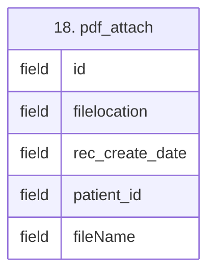

| Field | SQL Type | Key | Comment |
|---|---|---|---|
| `id` | `int(11)` | PK |  |
| `filelocation` | `text` |  |  |
| `rec_create_date` | `datetime` |  |  |
| `patient_id` | `int(11)` |  |  |
| `fileName` | `text` |  |  |

### 19. Table: presultupdate
- Purpose: 
- Key fields: id, group_type, patient_id, result_type, result_type_id, result_message, pathologist_id, pathologist2_id, release_time, release_type, second_patho_review, create_date
- Important notes: 
- Comment: 

```mermaid
erDiagram
TABLE_19["19. presultupdate"] {
  field id "Example: result update primary key"
  field group_type
  field patient_id "Example: result target patient"
  field result_type
  field result_type_id
  field result_message "Example: final pathology result text"
  field pathologist_id
  field pathologist2_id
  field release_time
  field release_type
  field second_patho_review
  field create_date
}
```

| Field | SQL Type | Key | Comment |
|---|---|---|---|
| `id` | `int(11)` | PK | Example: result update primary key |
| `group_type` | `int(11)` |  |  |
| `patient_id` | `int(11)` | INDEX | Example: result target patient |
| `result_type` | `varchar(50)` |  |  |
| `result_type_id` | `int(11)` |  |  |
| `result_message` | `text` |  | Example: final pathology result text |
| `pathologist_id` | `int(11)` | INDEX |  |
| `pathologist2_id` | `int(11)` | INDEX |  |
| `release_time` | `datetime` |  |  |
| `release_type` | `varchar(20)` |  |  |
| `second_patho_review` | `tinyint(4)` |  | 1 wait for review 2 approved |
| `create_date` | `datetime` |  |  |

### 20. Table: priority
- Purpose: 
- Key fields: id, priority
- Important notes: 
- Comment: 

```mermaid
erDiagram
TABLE_20["20. priority"] {
  field id "Example: lookup key"
  field priority
}
```

| Field | SQL Type | Key | Comment |
|---|---|---|---|
| `id` | `int(11)` | PK | Example: lookup key |
| `priority` | `varchar(20)` |  |  |

### 21. Table: questionnaire_quality_cn
- Purpose: 
- Key fields: id, patient_id, patient_num, score_specimen, score_staining, score_mounting, score_labeling, note
- Important notes: 
- Comment: 

```mermaid
erDiagram
TABLE_21["21. questionnaire_quality_cn"] {
  field id
  field patient_id
  field patient_num
  field score_specimen
  field score_staining
  field score_mounting
  field score_labeling
  field note
}
```

| Field | SQL Type | Key | Comment |
|---|---|---|---|
| `id` | `int(11)` | PK |  |
| `patient_id` | `int(11)` |  |  |
| `patient_num` | `varchar(11)` |  | cn??? |
| `score_specimen` | `int(11)` |  | 1.Specimen Procressing |
| `score_staining` | `int(11)` |  | 2.Staining |
| `score_mounting` | `int(11)` |  | 3.Mounting/Covering |
| `score_labeling` | `int(11)` |  | 4.Labeling |
| `note` | `text` |  | Note |

### 22. Table: questionnaire_quality_sn
- Purpose: 
- Key fields: id, patient_id, patient_num, score_thickness, score_staining, score_mounting, score_labeling, score_contaminate, note
- Important notes: 
- Comment: 

```mermaid
erDiagram
TABLE_22["22. questionnaire_quality_sn"] {
  field id
  field patient_id
  field patient_num
  field score_thickness
  field score_staining
  field score_mounting
  field score_labeling
  field score_contaminate
  field note
}
```

| Field | SQL Type | Key | Comment |
|---|---|---|---|
| `id` | `int(11)` | PK |  |
| `patient_id` | `int(11)` |  |  |
| `patient_num` | `varchar(11)` |  | sn??? |
| `score_thickness` | `int(11)` |  | 1.Thickness/Integrity |
| `score_staining` | `int(11)` |  | 2.Staining |
| `score_mounting` | `int(11)` |  | 3.Mounting/Covering |
| `score_labeling` | `int(11)` |  | 4.Labeling |
| `score_contaminate` | `int(11)` |  | 5.Contaminate |
| `note` | `text` |  | Note |

### 23. Table: quilljs_test
- Purpose: 
- Key fields: id, content, create_date, rsv
- Important notes: 
- Comment: 

```mermaid
erDiagram
TABLE_23["23. quilljs_test"] {
  field id
  field content
  field create_date
  field rsv
}
```

| Field | SQL Type | Key | Comment |
|---|---|---|---|
| `id` | `int(11)` | PK |  |
| `content` | `text` |  |  |
| `create_date` | `timestamp` |  |  |
| `rsv` | `text` |  |  |

### 24. Table: report_type
- Purpose: 
- Key fields: id, group_type, name, release_type, options
- Important notes: 
- Comment: 

```mermaid
erDiagram
TABLE_24["24. report_type"] {
  field id
  field group_type
  field name
  field release_type
  field options
}
```

| Field | SQL Type | Key | Comment |
|---|---|---|---|
| `id` | `int(11)` | UK |  |
| `group_type` | `int(11)` |  | 1 for mandatory require  2 for added later |
| `name` | `varchar(50)` |  | Name of report type |
| `release_type` | `varchar(20)` |  | Use for pick up to Patient database |
| `options` | `text` |  |  |

### 25. Table: req_id_sp_slide
- Purpose: 
- Key fields: id, patient_id, job_id, req_date, finish_date, create_user_id, comment, movetotrash
- Important notes: 
- Comment: 

```mermaid
erDiagram
TABLE_25["25. req_id_sp_slide"] {
  field id
  field patient_id
  field job_id
  field req_date
  field finish_date
  field create_user_id
  field comment
  field movetotrash
}
```

| Field | SQL Type | Key | Comment |
|---|---|---|---|
| `id` | `int(11)` | PK |  |
| `patient_id` | `int(11)` | INDEX, FK |  |
| `job_id` | `int(11)` | INDEX, FK |  |
| `req_date` | `datetime` |  |  |
| `finish_date` | `datetime` |  |  |
| `create_user_id` | `int(11)` |  |  |
| `comment` | `text` |  |  |
| `movetotrash` | `tinyint(4)` |  |  |

### 26. Table: service_billing
- Purpose: 
- Key fields: 
- Important notes: 
- Comment: 

```mermaid
erDiagram
TABLE_26["26. service_billing"] {
  field id "Example: billing item primary key"
  field req_date
  field req_finish_date
  field req_id
  field specimen_id
  field patient_id "Example: related patient"
  field number
  field name
  field lastname
  field slide_type
  field code_description
  field code2
  field description
  field nm_slide_count
  field sp_slide_block
  field sp_slide_count
  field import_date
  field report_date
  field price_hospital
  field hospital_id
  field hn
  field send_doctor
  field pathologist
  field cost "Example: total service cost"
  field comment
  field create_date
}
```

| Field | SQL Type | Key | Comment |
|---|---|---|---|
| `id` | `int(11)` | PK | Example: billing item primary key |
| `req_date` | `datetime` |  |  |
| `req_finish_date` | `datetime` |  |  |
| `req_id` | `int(11)` |  |  |
| `specimen_id` | `int(11)` |  | link for specimen id |
| `patient_id` | `int(11)` | INDEX, FK | Example: related patient |
| `number` | `varchar(32)` |  | Surgical Number |
| `name` | `varchar(120)` |  | patient name |
| `lastname` | `varchar(120)` |  | patient surname |
| `slide_type` | `tinyint(4)` |  | 1 สไลด์ปรกติ 2 ย้อมพิเศษ |
| `code_description` | `varchar(10)` |  | Ex: 33000 |
| `code2` | `int(11)` |  |  |
| `description` | `text` |  | description |
| `nm_slide_count` | `int(11)` |  | normal slide count |
| `sp_slide_block` | `text` |  | name of block require |
| `sp_slide_count` | `int(11)` |  | special slide count |
| `import_date` | `datetime` |  | วันที่รับเข้า |
| `report_date` | `datetime` |  | วันที่ออกผล |
| `price_hospital` | `varchar(120)` |  | ราคาตามโรงพยาบาล |
| `hospital_id` | `int(11)` |  |  |
| `hn` | `varchar(32)` |  | hospital number |
| `send_doctor` | `varchar(120)` |  | แพทย์ผู้ส่ง |
| `pathologist` | `varchar(32)` |  | หมอผู้ออกผล |
| `cost` | `int(11)` |  | Example: total service cost |
| `comment` | `text` |  |  |
| `create_date` | `datetime` |  | วันที่ให้บริการ |

### 27. Table: service_price_list
- Purpose: 
- Key fields: 
- Important notes: 
- Comment: 

```mermaid
erDiagram
TABLE_27["27. service_price_list"] {
  field id "Example: pricing row primary key"
  field number
  field speciment_num
  field code2
  field jobtype
  field specimen "Example: specimen type or service name"
  field hospital_id
  field unit_count
  field price "Example: unit price"
  field comment
  field create_date
  field add_user_id
  field edit_user_id
  field service_des
}
```

| Field | SQL Type | Key | Comment |
|---|---|---|---|
| `id` | `int(11)` | PK | Example: pricing row primary key |
| `number` | `int(11)` |  | ลำดับ |
| `speciment_num` | `int(10)` |  | code |
| `code2` | `int(11)` |  |  |
| `jobtype` | `tinyint(4)` |  | 1 ชิ้นเนื้อรับเข้า\r\n2 ย้อมพิเศษ |
| `specimen` | `text` |  | Example: specimen type or service name |
| `hospital_id` | `int(11)` |  | link to hospital id |
| `unit_count` | `varchar(30)` |  |  |
| `price` | `int(11)` |  | Example: unit price |
| `comment` | `text` |  |  |
| `create_date` | `datetime` |  |  |
| `add_user_id` | `int(11)` |  | คนที่สร้างข้อมูลนี้ |
| `edit_user_id` | `int(11)` |  | คนที่แก้ไขข้อมูลนี้ |
| `service_des` | `varchar(256)` |  |  |

### 28. Table: service_type
- Purpose: 
- Key fields: id, order_list, group_type, service_type, service_typea_id, service_typea_bill, service_type_bill, service_type_e, name_by_spcimen
- Important notes: 
- Comment: 

```mermaid
erDiagram
TABLE_28["28. service_type"] {
  field id
  field order_list
  field group_type
  field service_type
  field service_typea_id
  field service_typea_bill
  field service_type_bill
  field service_type_e
  field name_by_spcimen
}
```

| Field | SQL Type | Key | Comment |
|---|---|---|---|
| `id` | `int(11)` | PK |  |
| `order_list` | `int(11)` |  |  |
| `group_type` | `int(11)` |  |  |
| `service_type` | `varchar(120)` |  |  |
| `service_typea_id` | `int(11)` |  |  |
| `service_typea_bill` | `varchar(256)` |  |  |
| `service_type_bill` | `varchar(256)` |  |  |
| `service_type_e` | `varchar(120)` |  |  |
| `name_by_spcimen` | `varchar(120)` |  |  |

### 29. Table: service_type_master
- Purpose: 
- Key fields: id, code, code2, description, service_typeb_id, service_typeb_description, unit_count, price
- Important notes: 
- Comment: 

```mermaid
erDiagram
TABLE_29["29. service_type_master"] {
  field id
  field code
  field code2
  field description
  field service_typeb_id
  field service_typeb_description
  field unit_count
  field price
}
```

| Field | SQL Type | Key | Comment |
|---|---|---|---|
| `id` | `int(11)` | PK |  |
| `code` | `int(11)` |  |  |
| `code2` | `int(11)` |  |  |
| `description` | `varchar(256)` |  |  |
| `service_typeb_id` | `int(11)` |  |  |
| `service_typeb_description` | `varchar(256)` |  |  |
| `unit_count` | `varchar(256)` |  |  |
| `price` | `int(11)` |  |  |

### 30. Table: sn_prefix
- Purpose: 
- Key fields: id, order_list, name, description, description_e
- Important notes: 
- Comment: 

```mermaid
erDiagram
TABLE_30["30. sn_prefix"] {
  field id
  field order_list
  field name
  field description
  field description_e
}
```

| Field | SQL Type | Key | Comment |
|---|---|---|---|
| `id` | `int(11)` | PK |  |
| `order_list` | `int(11)` |  |  |
| `name` | `varchar(2)` |  | pre-fix name |
| `description` | `text` |  | description |
| `description_e` | `text` |  |  |

### 31. Table: status
- Purpose: 
- Key fields: id, des, next1, next2, next3, back1, back2
- Important notes: 
- Comment: 

```mermaid
erDiagram
TABLE_31["31. status"] {
  field id "Example: lookup key"
  field des
  field next1
  field next2
  field next3
  field back1
  field back2
}
```

| Field | SQL Type | Key | Comment |
|---|---|---|---|
| `id` | `int(11)` | PK | Example: lookup key |
| `des` | `varchar(3000)` |  |  |
| `next1` | `int(11)` |  |  |
| `next2` | `int(11)` |  |  |
| `next3` | `int(11)` |  |  |
| `back1` | `int(11)` |  |  |
| `back2` | `int(11)` |  |  |

### 32. Table: template_report
- Purpose: 
- Key fields: 
- Important notes: 
- Comment: 

```mermaid
erDiagram
TABLE_32["32. template_report"] {
  field id "Example: template primary key"
  field user_id
  field reporttype_id
  field name "Example: template display name"
  field description "Example: report layout notes"
}
```

| Field | SQL Type | Key | Comment |
|---|---|---|---|
| `id` | `int(11)` | PK | Example: template primary key |
| `user_id` | `int(11)` |  |  |
| `reporttype_id` | `int(11)` |  |  |
| `name` | `varchar(100)` |  | Example: template display name |
| `description` | `text` |  | Example: report layout notes |

### 33. Table: testtiptap
- Purpose: 
- Key fields: id, content
- Important notes: 
- Comment: 

```mermaid
erDiagram
TABLE_33["33. testtiptap"] {
  field id
  field content
}
```

| Field | SQL Type | Key | Comment |
|---|---|---|---|
| `id` | `int(11)` | PK |  |
| `content` | `text` |  |  |

### 34. Table: user
- Purpose: 
- Key fields: 
- Important notes: 
- Comment: 

```mermaid
erDiagram
TABLE_34["34. user"] {
  field id "Example: user primary key"
  field username "Example: login account name"
  field password
  field pre_name
  field name
  field lastname
  field pre_name_e
  field name_e
  field lastname_e
  field short_name
  field educational_bf
  field role
  field role_1
  field role_2
  field role_3
  field role_4
  field role_5
  field role_6
  field role_7
  field role_a
  field can_manaage_job
  field udetail
  field umobile
  field uemail
  field ugroup_id
  field uhospital_id "Example: linked hospital"
  field signature_file
  field profile_file
  field user_status
  field user_type
  field create_date
  field create_by
  field movetotrash
}
```

| Field | SQL Type | Key | Comment |
|---|---|---|---|
| `id` | `int(11)` | PK | Example: user primary key |
| `username` | `char(255)` | UK | Example: login account name |
| `password` | `char(255)` |  |  |
| `pre_name` | `varchar(10)` |  | คำนำหน้าชื่อภาษาไทย |
| `name` | `varchar(128)` |  |  |
| `lastname` | `varchar(128)` |  |  |
| `pre_name_e` | `varchar(20)` |  |  |
| `name_e` | `varchar(20)` |  |  |
| `lastname_e` | `varchar(20)` |  |  |
| `short_name` | `varchar(16)` |  |  |
| `educational_bf` | `varchar(10)` |  | วุฒิการศึกษา ex แพทย์ศาสตร์มหาบัณฑิต (Medicinae Doctor/Doctor of Medicine) |
| `role` | `varchar(20)` |  | Ex: Pathologist |
| `role_1` | `tinyint(1)` |  | ตัดเนื้อ Cross Section |
| `role_2` | `tinyint(1)` |  | คนจด Cross Section Assistent |
| `role_3` | `tinyint(1)` |  | เตรียมสไลด์ Slide Prepareation |
| `role_4` | `tinyint(1)` |  | Special Slide Prepareation |
| `role_5` | `tinyint(1)` |  | Pathologist |
| `role_6` | `tinyint(1)` |  | Second pathologist |
| `role_7` | `tinyint(1)` |  | Cycologist |
| `role_a` | `tinyint(4)` |  | จำลอง เจ้าแพทย์ของเคส |
| `can_manaage_job` | `tinyint(4)` |  |  |
| `udetail` | `text` |  |  |
| `umobile` | `text` |  |  |
| `uemail` | `text` |  |  |
| `ugroup_id` | `int(11)` | INDEX |  |
| `uhospital_id` | `int(11)` | INDEX | Example: linked hospital |
| `signature_file` | `varchar(50)` |  |  |
| `profile_file` | `varchar(50)` |  |  |
| `user_status` | `tinyint(4)` |  | 0:inActive 1:Active |
| `user_type` | `tinyint(4)` |  | 0 user as person  1 user as hospital |
| `create_date` | `datetime` |  |  |
| `create_by` | `varchar(80)` |  |  |
| `movetotrash` | `tinyint(4)` |  |  |

### 35. Table: user_groups
- Purpose: 
- Key fields: id, ugroup, ugroup_e
- Important notes: 
- Comment: 

```mermaid
erDiagram
TABLE_35["35. user_groups"] {
  field id "Example: lookup key"
  field ugroup
  field ugroup_e
}
```

| Field | SQL Type | Key | Comment |
|---|---|---|---|
| `id` | `int(11)` | PK | Example: lookup key |
| `ugroup` | `varchar(30)` |  |  |
| `ugroup_e` | `varchar(30)` |  |  |
